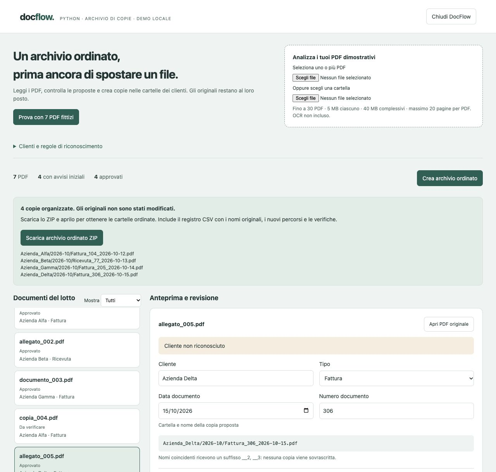

# DocFlow — assistente per l'archiviazione documentale

Prototipo Python locale: legge PDF, propone cliente/tipo/data/numero, permette la revisione e genera un archivio ZIP di copie ordinate. Ogni documento richiede approvazione esplicita. Gli originali non sono rinominati, spostati o cancellati.



## Download per Mac e Windows

| Pacchetto | Sistema | File da aprire dopo l’estrazione |
|---|---|---|
| `DocFlow_MAC.zip` | macOS Apple Silicon | `DocFlow.app` |
| `DocFlow_WINDOWS_x64.zip` | Windows 10/11 x64 Intel/AMD | `APRI DOCFLOW.cmd` |

Entrambi includono Python: non occorre installarlo. Scaricare il pacchetto adatto dalla sezione Releases del repository **privato**. La demo Mac è stata eseguita su macOS; il pacchetto Windows è stato assemblato e ispezionato su Mac, ma la prova esecutiva su Windows è ancora da completare.

## Avvio sul Mac
Nella distribuzione per il Mac apri **DocFlow.app** con doppio clic. Include il runtime Python e apre l'interfaccia nel browser. Premi **Prova con 7 PDF fittizi**. Per uscire usa **Chiudi DocFlow** nella pagina: chiudere solo la scheda lascia il servizio locale attivo, riapribile dall'app.

Il pacchetto Mac è per Apple Silicon, non per Mac Intel. Il download Windows è separato e contiene il runtime Windows x64. I sorgenti sono Python e si possono avviare separatamente su sistemi con Python 3.10 o successivo. Il pacchetto Mac è una build locale, non notarizzata per distribuzione pubblica.

## Avvio su Windows
Estrai **tutto** `DocFlow_WINDOWS_x64.zip` e apri `APRI DOCFLOW.cmd`. Mantieni insieme il comando e le cartelle `app` e `runtime`. Non avviare il comando dall’interno dello ZIP. Il browser apre la stessa interfaccia della versione Mac. Per uscire usa **Chiudi DocFlow**.

Sessione e log di avvio sono in `%LOCALAPPDATA%\DocFlow Demo`. Il runtime incorporato è Python 3.14.10 x64, proveniente da [Python.org](https://www.python.org/downloads/release/python-31410/), con verifica SHA-256 durante la build; provenienza e hash sono inclusi nel pacchetto.

## Sorgenti

```sh
python3 server.py
python3 -m unittest discover -s tests
```

La dipendenza `pypdf` è inclusa in `vendor/`, con la relativa licenza: non serve installarla per l'avvio dai sorgenti. `make_examples.py` è solo lo script di sviluppo per ricreare i PDF e richiede reportlab e Pillow; i PDF sono già presenti. Per condividere il codice, utilizzare questa cartella Repository, non il contenuto del bundle Mac.

## Caso dimostrativo
Sette PDF fittizi: tre documenti con metadati completi, una copia identica, una fattura di un cliente fuori anagrafica, una scansione senza testo e una ricevuta senza data. Le proposte sono calcolate dal testo, non codificate per nome file.

L'operatore può correggere campi mancanti, approvare solo i documenti desiderati e scaricare uno ZIP con percorsi come:

```text
Azienda_Alfa/2026-10/Fattura_104_2026-10-12.pdf
Azienda_Beta/2026-10/Ricevuta_77_2026-10-13.pdf
REGISTRO_ARCHIVIAZIONE.csv
LEGGIMI.txt
```

I nomi vengono resi compatibili con le comuni restrizioni dei filesystem. Un suffisso `__2`, `__3` evita nomi coincidenti; nessuna copia viene sovrascritta. Il registro documenta dati approvati, avvisi iniziali e hash SHA-256 degli originali. I PDF copiati restano identici byte per byte.

## Regole della prima versione
- Anagrafica configurabile: una riga per cliente, `Nome | alias; altri alias`. Si applica alla prossima analisi.
- Il cliente viene cercato come nome/alias intero nel testo. Più clienti riconosciuti richiedono revisione.
- Tipi previsti: intestazioni Fattura o Ricevuta nelle prime righe. Ambiguità: revisione manuale.
- Data e numero: etichette esplicite, come `Data documento:` e `Numero documento:`. Date ISO o italiane GG/MM/AAAA; non si indovina la convenzione di data di altri paesi.
- PDF con testo insufficiente: nessun OCR, revisione manuale dei campi.
- Copie identiche: rilevate tramite SHA-256 e segnalate. Non sono automaticamente archiviate né eliminate.
- PDF danneggiati, protetti non leggibili oppure oltre 20 pagine: esclusi dalla creazione delle copie in questa demo.

Massimo 30 PDF, 5 MB ciascuno e richiesta complessiva entro 40 MB. Le cartelle selezionate sono filtrate ai soli PDF. Non viene eseguito un monitoraggio delle cartelle: si analizza soltanto il lotto scelto.

## Limiti e conservazione dei dati
Solo documenti fittizi nella demo. Non è un classificatore universale, un sistema di conservazione a norma o un DMS con versioni e permessi. Non invia documenti a servizi esterni. Il server ascolta solo su 127.0.0.1 con un percorso di sessione casuale.

Caricamenti, modifiche e archivi sono mantenuti in memoria; il servizio può conservare gli ultimi tre ZIP fino alla chiusura. Scarica il risultato prima di chiudere. Le copie vengono create nello ZIP: estrailo per ottenere una nuova cartella ordinata. Non si scrive nella cartella degli originali.

Il file di sessione e il log di avvio risiedono in `~/Library/Application Support/DocFlow Demo` su Mac. Il log non è un archivio dei documenti. Nessuna parte di questo progetto è stata pubblicata su GitHub automaticamente.

Per ricostruire l’app Mac in sviluppo, installa PyInstaller e usa `build_macos.sh`. La distribuzione contiene le licenze delle librerie incorporate nelle risorse del bundle.

## Build Windows e verifica su Windows

```sh
python scripts/build_windows.py
```

La build prepara `release/windows/DocFlow_WINDOWS_x64.zip`, scarica il runtime ufficiale e verifica il suo hash. Non esegue binari Windows sul Mac. La cache del runtime e gli output non vanno caricati nel repository.

Per eseguire la prova del pacchetto **su Windows**:

```sh
python tests/smoke_server.py --package "release/windows/DocFlow Windows"
```

La prova usa il Python incorporato, anche con un percorso contenente spazi e caratteri accentati, e controlla avvio, classificazione dei sette PDF, correzione manuale, archivio, hash delle copie, gestione dei duplicati e chiusura.

È incluso il workflow `.github/workflows/verifica-windows.yml`, avviabile solo manualmente dalla scheda **Actions** dopo il caricamento nel repository privato. Esegue test e build su un runner Windows e conserva lo ZIP come artifact privato per sette giorni. Non crea repository, release o pubblicazioni pubbliche. Qui è stato preparato, non ancora eseguito su GitHub.

```sh
python tests/smoke_server.py
```

Quest’ultimo comando verifica il servizio dai sorgenti anche sul Mac. Le verifiche dell’avvio comprendono opzioni distinte per Mac e Windows, evitando la console del server in Windows.

## Codice privato e video pubblici
Vedere [la guida di pubblicazione](docs/PUBBLICAZIONE.md). I video possono essere ospitati in uno spazio pubblico separato; mantenere privato questo repository. Un video incluso soltanto in questo repository privato non è accessibile ai visitatori esterni.
